<!-- Generated by "npm run build" from config/profile.json. Edit the config or src/, not this file. -->

<a href="https://frankport.pages.dev">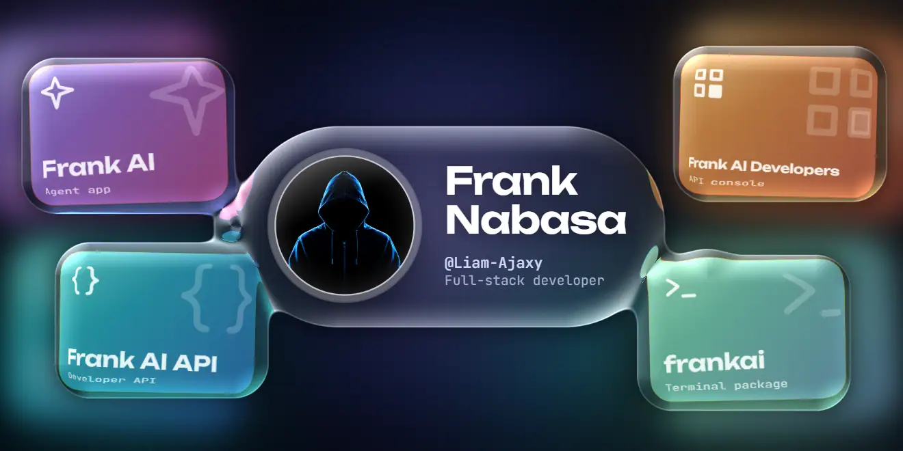</a>


<a href="https://frankport.pages.dev/ai">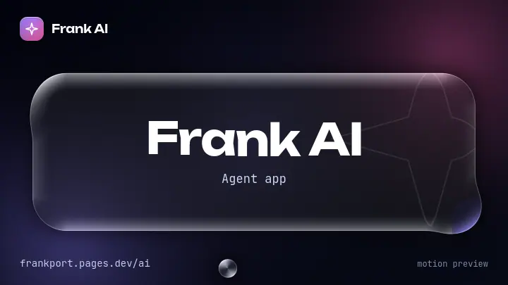</a>
<a href="https://api.frankai.workers.dev">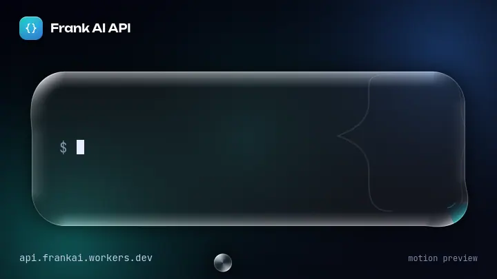</a>
<a href="https://developer.frankapi.workers.dev">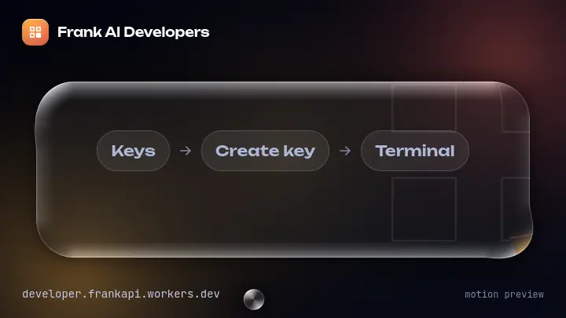</a>
<a href="https://www.npmjs.com/package/frankai">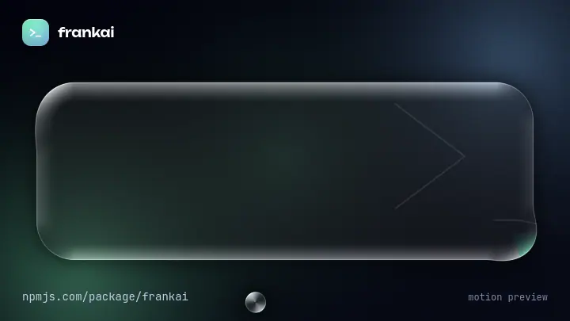</a>


<a href="https://frankport.pages.dev/ai"></a>
<a href="https://api.frankai.workers.dev"></a>
<a href="https://developer.frankapi.workers.dev"></a>
<a href="https://www.npmjs.com/package/frankai"></a>

<a href="https://frankport.pages.dev/ai"><code>frankport.pages.dev/ai</code></a>&nbsp;&nbsp;&nbsp;&nbsp;<a href="https://api.frankai.workers.dev"><code>api.frankai.workers.dev</code></a>&nbsp;&nbsp;&nbsp;&nbsp;<a href="https://developer.frankapi.workers.dev"><code>developer.frankapi.workers.dev</code></a>&nbsp;&nbsp;&nbsp;&nbsp;<a href="https://www.npmjs.com/package/frankai"><code>npmjs.com/package/frankai</code></a>

 



